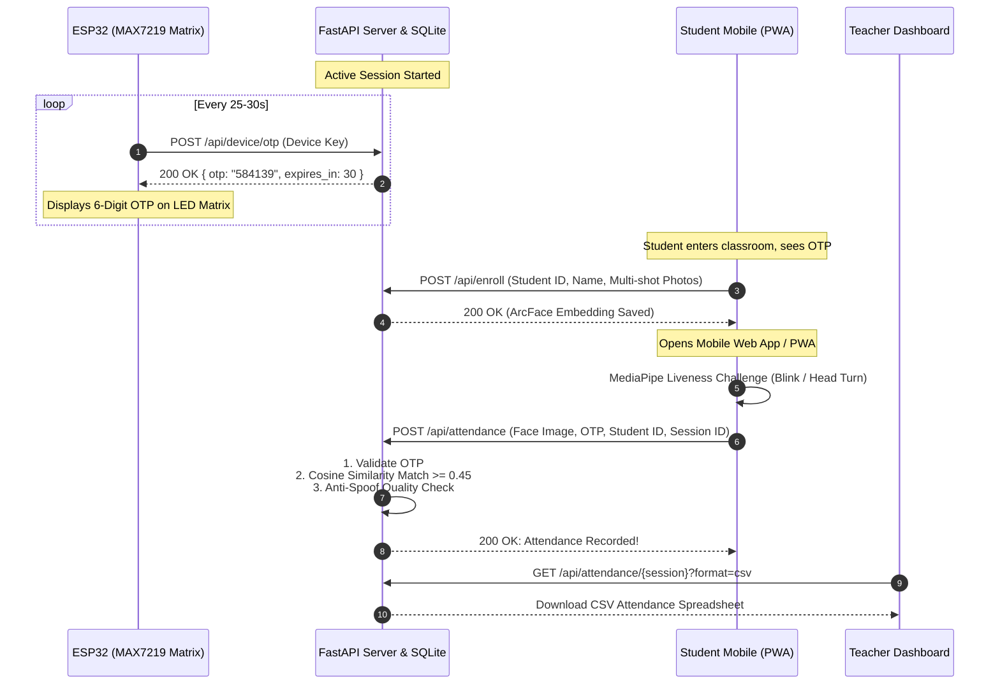

# IoT Smart Attendance System: ESP32 OTP & ArcFace Facial Recognition

A production-ready, anti-spoofing smart attendance system combining an **ESP32 microcontroller + MAX7219 LED dot matrix display** for dynamic classroom OTP generation, **InsightFace (ArcFace embeddings)** for high-precision facial recognition, **MediaPipe Face Mesh** for in-browser interactive liveness verification, and a **FastAPI + SQLite** backend with teacher session control and CSV exports.

---

## System Architecture



---

## Features

- **Microcontroller (ESP32 + MAX7219 Dot Matrix)**:
  - Fetches rotating OTP from backend over WiFi using `HTTPClient` and `ArduinoJson`.
  - Displays centered 6-digit OTP on a 4-in-1 MAX7219 32x8 LED matrix using `MD_Parola` and `MD_MAX72XX`.
  - Subtle LED heartbeat showing sync and timer status.
  - Auto-reconnect with fallback animations (`WIFI...`, `RECONN`, `SRV ERR`).

- **Backend (Python 3.10+ / FastAPI / SQLite)**:
  - **ArcFace Facial Recognition**: Deep neural embeddings via **InsightFace** (`buffalo_s` / ArcFace) with fallback to **OpenCV DNN SFace / YuNet**.
  - **Dynamic Rotating OTP**: Synchronized time windows (30s) with single-use replay protection.
  - **Server-Side Liveness & Anti-Spoofing**: Laplacian variance blur detection, single-face validation, and detection confidence scoring.
  - **Multi-Shot Registration**: Averages multiple face angles into a normalized master template.
  - **SQLite Database**: Stores embeddings as serialized JSON/vectors (raw photos are not stored for privacy).

- **Mobile Web App & PWA Frontend**:
  - Progressive Web App (`manifest.json`, `sw.js` service worker) giving a native mobile app feel.
  - Camera access via `navigator.mediaDevices.getUserMedia`.
  - **Interactive Liveness Detection**: Google MediaPipe Face Mesh running client-side to track Eye Aspect Ratio (EAR) blinks before auto-capturing.
  - Live virtual LED display simulator for remote testing.
  - Responsive dark-mode glassmorphism UI.

- **Teacher & Admin Dashboard**:
  - Live attendance monitoring with real-time polling.
  - One-click **CSV export** for grading and records.

---

## Hardware Setup & Wiring

### Components:
1. **ESP32 Development Board** (ESP32-WROOM-32 / NodeMCU ESP32)
2. **MAX7219 4-in-1 Dot Matrix LED Display Module** (FC-16 type, 32x8 red LEDs)
3. **5x Dupont Jumper Wires** (Female-to-Female or Male-to-Female)
4. **Micro-USB Cable** for power and serial programming

### Pinout Table:

| MAX7219 Pin | ESP32 GPIO Pin | Description |
| :--- | :--- | :--- |
| **VCC** | **VIN / 5V** | 5V Power Supply |
| **GND** | **GND** | Ground |
| **DIN** | **GPIO 23** | SPI MOSI (Data In) |
| **CS** | **GPIO 5** | SPI SS (Chip Select) |
| **CLK** | **GPIO 18** | SPI SCK (Clock) |

> [!NOTE]
> If your MAX7219 display shows mirrored or upside-down characters, you can change the module type in the `.ino` sketch: `MD_MAX72XX::FC16_HW` (standard), `GENERIC_HW`, or `ICSTATION_HW`.

---

## Quick Start Guide

### 1. Backend Setup

```bash
# Navigate to backend folder
cd backend

# Install dependencies
pip install -r requirements.txt

# Run the backend server
python run.py
```
- Server URL: `http://localhost:8000`
- Interactive OpenAPI / Swagger Docs: `http://localhost:8000/docs`
- Web App UI: `http://localhost:8000/`

---

### 2. ESP32 Firmware Flashing

#### Option A: Using Arduino IDE
1. Open Arduino IDE.
2. In **Tools > Manage Libraries...**, install:
   - `MD_Parola` by majicDesigns
   - `MD_MAX72XX` by majicDesigns
   - `ArduinoJson` by Benoit Blanchon (v6 or v7)
3. In **Tools > Board**, select **ESP32 Dev Module**.
4. Open [esp32_otp_display.ino](file:///c:/Users/Sriyansh%20Patel/OneDrive/Desktop/pro/esp32/esp32_otp_display.ino).
5. Update your WiFi credentials and server URL:
   ```cpp
   const char* WIFI_SSID     = "Your_WiFi_SSID";
   const char* WIFI_PASSWORD = "Your_WiFi_Password";
   const char* SERVER_URL    = "http://YOUR_LOCAL_PC_IP:8000/api/device/otp";
   const char* DEVICE_KEY    = "esp32_classroom_key_98765";
   ```
6. Click **Upload** and open **Serial Monitor** (115200 baud).

#### Option B: Using PlatformIO
```bash
cd esp32
pio run --target upload --target monitor
```

---

### 3. HTTPS Configuration for Mobile Phone Testing

> [!IMPORTANT]
> Modern phone browsers (Chrome for Android, iOS Safari) strictly block camera access (`getUserMedia`) on unencrypted HTTP connections unless the origin is `localhost`. To test on a real phone:

#### Method 1: Cloudflare Tunnel (Free & Fast, No Account Required)
```bash
# Run cloudflared tunnel pointing to your local FastAPI server
cloudflared tunnel --url http://localhost:8000
```
Open the generated `https://xxxx.trycloudflare.com` URL in your mobile phone browser.

#### Method 2: ngrok
```bash
ngrok http 8000
```
Open the `https://xxxx.ngrok-free.app` URL on your phone.

---

## API Specification

### 1. ESP32 OTP Generation
- **Endpoint**: `POST /api/device/otp`
- **Headers**: `Content-Type: application/json`
- **Request Body**:
  ```json
  {
    "device_key": "esp32_classroom_key_98765"
  }
  ```
- **Response** (`200 OK`):
  ```json
  {
    "otp": "584139",
    "expires_in": 30,
    "expiry": "2026-11-21T14:30:00+00:00",
    "session_id": "SESSION_DEFAULT",
    "status": "active"
  }
  ```

---

### 2. Student Enrollment
- **Endpoint**: `POST /api/enroll`
- **Option A (Multipart Form)**:
  - `student_id`: `STU-2026-001`
  - `name`: `Sarah Connor`
  - `department`: `Computer Science`
  - `photos`: One or more image files (`.jpg`, `.png`)
- **Option B (Base64 JSON)**:
  ```json
  {
    "student_id": "STU-2026-001",
    "name": "Sarah Connor",
    "department": "Computer Science",
    "images_base64": ["data:image/jpeg;base64,..."]
  }
  ```
- **Response** (`200 OK`):
  ```json
  {
    "status": "success",
    "message": "Student Sarah Connor (STU-2026-001) successfully enrolled.",
    "student_id": "STU-2026-001",
    "name": "Sarah Connor",
    "department": "Computer Science",
    "shots_processed": 3,
    "embedding_dimensions": 512
  }
  ```

---

### 3. Attendance Verification
- **Endpoint**: `POST /api/attendance`
- **Option A (Multipart Form)**:
  - `student_id`: `STU-2026-001`
  - `session_id`: `SESSION_DEFAULT`
  - `otp`: `584139`
  - `face_image`: Selfie photo file
- **Option B (Base64 JSON)**:
  ```json
  {
    "student_id": "STU-2026-001",
    "session_id": "SESSION_DEFAULT",
    "otp": "584139",
    "image_base64": "data:image/jpeg;base64,..."
  }
  ```
- **Response** (`200 OK`):
  ```json
  {
    "status": "success",
    "message": "Attendance verified successfully for Sarah Connor.",
    "student_id": "STU-2026-001",
    "name": "Sarah Connor",
    "session_id": "SESSION_DEFAULT",
    "similarity_score": 0.942,
    "threshold": 0.45,
    "timestamp": "2026-11-21T14:31:05.120Z"
  }
  ```

---

### 4. Session Attendance & CSV Export
- **Endpoint**: `GET /api/attendance/{session}`
- **Parameters**: `?format=json` (default) or `?format=csv`
- **CSV Response Example**:
  ```csv
  ID,Session ID,Student ID,Student Name,Department,Timestamp,Match Score,Status,OTP Used
  1,SESSION_DEFAULT,STU-2026-001,Sarah Connor,Computer Science,2026-11-21 14:31:05,0.942,PRESENT,584139
  ```

---

## Testing with Postman

1. Open Postman.
2. Click **Import** and select:
   [Smart_Attendance_System.postman_collection.json](file:///c:/Users/Sriyansh%20Patel/OneDrive/Desktop/pro/postman/Smart_Attendance_System.postman_collection.json)
3. Set your collection variables:
   - `base_url`: `http://localhost:8000` (or your tunnel URL)
   - `device_key`: `esp32_classroom_key_98765`
   - `session_id`: `SESSION_DEFAULT`
4. Run requests in sequence:
   1. `POST /api/device/otp`
   2. `POST /api/enroll`
   3. `POST /api/attendance`
   4. `GET /api/attendance/{session}?format=csv`

---

## Automated Verification Suite

Run the built-in end-to-end integration test suite:

```bash
python test_system.py
```

All 7 core validation checks (auth rejection, OTP rotation, embedding extraction, invalid OTP rejection, face verification, JSON listing, and CSV export) run and verify in seconds.
# smart_attendance

# p2

